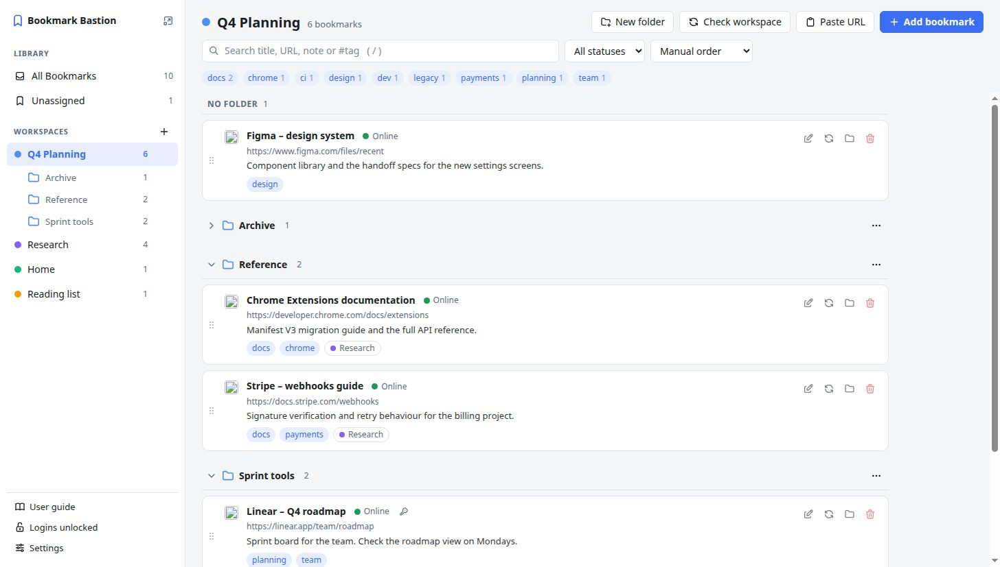

# Bookmark Bastion

**A workspace-based bookmark manager for Chromium browsers** (Chrome, Edge, Brave, Vivaldi, Opera and others). Keep every bookmark in one place and group them into as many workspaces as you like, without ever saving a page twice.

- **Version:** 1.43.6 · [release notes](https://github.com/DoggByte/bookmark-bastion/releases/tag/v1.43.6) · [CHANGELOG](CHANGELOG.md)
- **Author:** DoggByte · [doggbyte.com](https://doggbyte.com) · [doggbyte@bert2go.com](mailto:doggbyte@bert2go.com)
- **Works in:** any Chromium-based browser that runs Chrome extensions (version 110 or newer). Firefox and Safari are not supported.
- **Privacy:** no account, no server, no tracking. Your library stays on your computer.
- **Terms:** free to install and use, not to change. See [COPYRIGHT.md](COPYRIGHT.md).

  <picture>
    <source media="(prefers-color-scheme: dark)" srcset="images/manager-dark.jpg">
    
  </picture>

## What it does

- Save the page you are on with one click, a shortcut or the right-click menu, and file it into one or more workspaces.
- Organise a workspace into folders, and keep the same bookmark in several places without copies.
- Add descriptions, notes and tags, then search them.
- Keep saved logins (username, password, two-factor codes) encrypted with a passphrase only you know, and fill them in with one click.
- Import your browser's bookmarks, export everything to a file, and move your library between computers.

The full story is in the [user guide](USER-GUIDE.md).

## Install it

Bookmark Bastion is **not in a web store**, so you install it by hand. It takes about two minutes and works the same in every Chromium browser.

1. **Download** [`bookmark-bastion-v1.43.6.zip`](https://github.com/DoggByte/bookmark-bastion/releases/download/v1.43.6/bookmark-bastion-v1.43.6.zip) from the [latest release](https://github.com/DoggByte/bookmark-bastion/releases/tag/v1.43.6).
   *(Optional: check the download against `SHA256SUMS.txt` from the same page. On Linux or macOS run `shasum -a 256 bookmark-bastion-v1.43.6.zip`, on Windows `certutil -hashfile bookmark-bastion-v1.43.6.zip SHA256`. The two values must be identical.)*
2. **Unzip it into a folder that will stay where it is**, for example `Documents\Bookmark Bastion` or `~/Apps/bookmark-bastion`. The browser loads the extension from this folder every time it starts, so do not put it in Downloads or on the Desktop, and do not delete it afterwards. After unzipping, the folder must contain a file named `manifest.json` directly inside it, not inside another folder.
3. **Open the extensions page** of your browser: type `chrome://extensions` in the address bar (`edge://extensions` in Edge, `brave://extensions` in Brave, `vivaldi://extensions` in Vivaldi, `opera://extensions` in Opera) and press Enter.
4. **Turn on Developer mode.** The switch is at the top right (in Edge it is at the bottom left of the page, in Opera at the top right).
5. **Click "Load unpacked"** and choose the folder from step 2, the one that holds `manifest.json`, then confirm.
6. **Bookmark Bastion now appears in the list.** Click the puzzle-piece icon in the toolbar and pin it, so its button is always visible.
7. **Start.** A first-run page opens and offers to import the bookmarks already in your browser. You can accept, choose how they are organised, or skip it and do it later (Settings → Backup & transfer).

Then open any website and click the toolbar button, or press `Alt+Shift+S`, to save your first page. `Alt+Shift+M` opens the manager.

### Updating to a new version

1. **Export a backup first:** manager → Settings → Backup & transfer → Export JSON.
2. Download the zip of the [latest release](https://github.com/DoggByte/bookmark-bastion/releases/latest) and **unzip it over the same folder**, replacing the old files. (To find out whether a newer version exists, press **Settings → Updates → Check for updates** in the manager. It asks GitHub for the newest release, one request and only when you press the button.)
3. Open the extensions page and click the **reload** (circular arrow) button on Bookmark Bastion.

Always reuse the same folder. The browser ties the extension, and the library stored with it, to that folder. Loading the new version from a different folder creates a second, empty copy; your library is still in the first one (and can be exported from there).

### Removing it

Removing the extension on the extensions page deletes the library stored with it, so export a backup first.

### If something goes wrong

| What you see | What to do |
| --- | --- |
| "Manifest file is missing or unreadable" | You chose the wrong folder. Pick the folder that has `manifest.json` directly inside it; with some unzip tools that is a folder inside the one you created. |
| There is no "Load unpacked" button | Developer mode is off (step 4), or your computer's administrator has turned it off. On a managed computer ask them to allow it. |
| A "Disable developer mode extensions" warning when the browser starts | Browsers show this for every extension installed by hand. Dismiss it; do not click "Disable". |
| The extension disappeared after moving or deleting its folder | Put the folder back in the same place and click reload, or load it again from where it is now. A library is only lost if you removed the extension itself. |
| Other problems | Write to [doggbyte@bert2go.com](mailto:doggbyte@bert2go.com) with your browser, its version and what happened. |

## Free and Pro

Bookmark Bastion is free to use. **Pro** is an optional license that unlocks more.

| | Free | Pro |
| --- | --- | --- |
| Bookmarks, workspaces, folders, tags, drag and drop, search, the pop-up | Everything | Everything |
| Export, import (including your browser's bookmarks) and the encrypted library | Everything | Everything |
| [Saved logins](USER-GUIDE.md#logins) | Up to **5** | No limit |
| [Browser sign-in prompts](USER-GUIDE.md#logins-httpauth) | Not answered | Answered from a saved login |
| [Smartspaces](USER-GUIDE.md#smartspaces) | The default one | Create your own |
| [Importing browser history](USER-GUIDE.md#backup-history) | | Included |
| [Selecting several bookmarks](USER-GUIDE.md#selecting) and dragging the selection | | Included |
| [Scanning QR pictures](USER-GUIDE.md#saving-qr) | One picture at a time | Up to 10 at a time |

Without a license **nothing is ever hidden or deleted**: logins, smartspaces and settings you already have stay readable, usable and exportable, and a control that needs Pro carries a **PRO** badge that explains what to do.

**Getting Pro:** go to [ko-fi.com/doggbyte](https://ko-fi.com/doggbyte) and choose **$5 for a 1-year license** or **$10 for a lifetime license**. **In the Ko-fi note, write which license you want (1-year or lifetime) and the email address to send the key to.** Your license key (it starts with `BB1.`) is sent to that address within 24 hours, and Pro includes support and free updates for the length of the license you choose. Already have a 1-year license and want the lifetime one? Make another **$10** payment and write in the note that it is an upgrade, together with your 1-year activation key and the email address to send the new key to. Questions: [doggbyte@bert2go.com](mailto:doggbyte@bert2go.com). Open the manager, go to **Settings → Bookmark Bastion Pro**, paste the key and press **Activate**. The key is checked on your computer, with no account and no internet connection. See [Bookmark Bastion Pro](USER-GUIDE.md#pro) in the guide for details, including what happens when a key with an end date runs out.

## More

- [User guide](USER-GUIDE.md): every feature, step by step
- [CHANGELOG](CHANGELOG.md): what changed in each version
- [COPYRIGHT](COPYRIGHT.md): the terms of use
- [Third-party licenses](THIRD-PARTY-LICENSES.md): the open source parts inside Bookmark Bastion

© 2026 DoggByte. All rights reserved.
