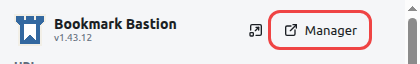
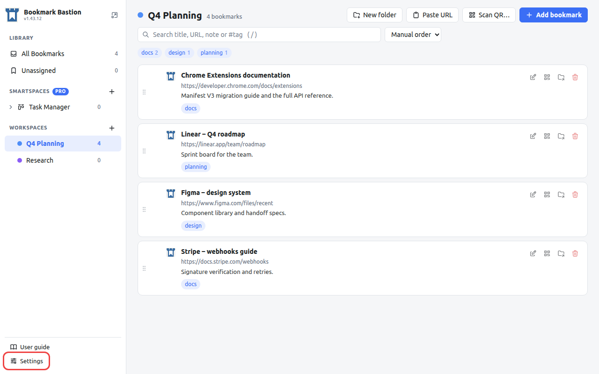
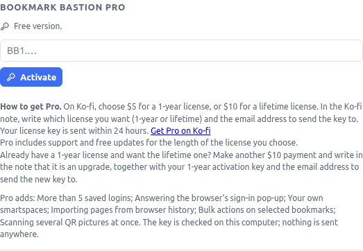
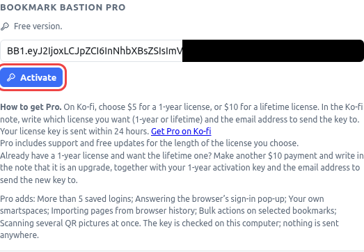
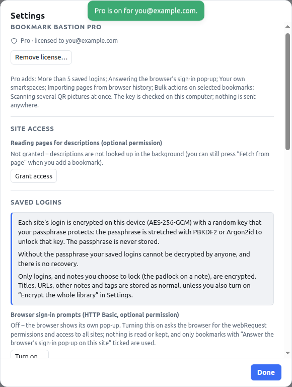
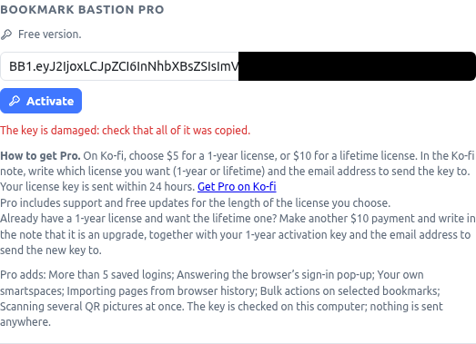

# How to activate Bookmark Bastion Pro

Bookmark Bastion is free to use. **Pro** is an optional license that unlocks more: no limit on saved logins, answering the browser's sign-in pop-ups, your own smartspaces, importing from your browser history, selecting several bookmarks at once and scanning several QR pictures at once. You turn it on by entering the **license key** you receive after buying Pro.

This tutorial takes about a minute. You need:

- Bookmark Bastion installed in your browser.
- Your license key. It starts with `BB1.` and arrives by email within 24 hours of your Ko-fi payment. If you don't have one yet, see [Getting a key](#getting-a-key) at the end.

The key is checked on your computer. No account is needed, nothing is sent anywhere and activation works without an internet connection.

> The pictures below use a made-up address (`you@example.com`) and a sample key that does not work. Your own key is longer, and the status line shows the email address your key was issued to.

## 1. Open the manager

Click the Bookmark Bastion button in your browser's toolbar (the puzzle-piece menu lists it if you haven't pinned it). In the pop-up that opens, press **Manager**.

The manager opens in a new tab. It is the full-page view of your bookmarks, and it is where Settings lives.

## 2. Open Settings

At the bottom of the sidebar on the left, press **Settings**.

## 3. Find the Bookmark Bastion Pro section

The **Bookmark Bastion Pro** section is the first one in the Settings window. Until a key is entered it says **Free version.** and shows an empty box with `BB1.…` in it.

Anything in the app that needs Pro carries a **PRO** badge. Clicking one opens a notice with an **Add license key** button that brings you straight to this box.

## 4. Paste your key and press Activate

Copy the whole key from your email and paste it into the box. Spaces and line breaks that come along with a copied key are ignored, so don't worry about tidying it.

Press **Activate** (or press Enter).

## 5. Check that Pro is on

A green message says **Pro is on for** your email address, and the section changes:

- The status line reads **Pro · licensed to** *your email address*. If your license has an end date, it also says **valid until** that date.
- The key box and the **Activate** button disappear. There is nothing more to do.
- A **Remove license…** button appears. It turns Pro off again.

Press **Done**. The features that were marked **PRO** are open now.

## If the key is refused

A key that was cut short, changed or made for something else is refused with a message, and nothing is saved. Your copy stays in the free version.

The usual cause is that part of the key was lost when it was copied. Copy it again from the email, check that you got everything from `BB1.` to the very end, and paste it into the box again. If it still fails, reply to the email your key arrived in and include the exact message.

## Good to know

- **Your other browsers.** The key is kept in the browser's synced extension storage, so it also turns up in your other browsers signed in to the same browser account, if that browser syncs extension data. Other browsers or profiles that don't sync need the key entered once each.
- **Keep the key somewhere safe.** It is not part of your library: **Export JSON** doesn't include it and **Erase everything** doesn't remove it, so you can always enter it again.
- **A license with an end date** keeps working for 14 days after that date, so a renewal that is a little late costs nothing. After that the extension goes back to the free version. Nothing you saved is deleted, and entering a renewed key turns Pro on again.
- **Removing the license** (**Settings → Bookmark Bastion Pro → Remove license…**) turns Pro off. Your bookmarks, logins and settings stay exactly as they are.

## Getting a key

1. Go to [ko-fi.com/doggbyte](https://ko-fi.com/doggbyte) and choose **$5 for a 1-year license** or **$10 for a lifetime license**.
2. **In the Ko-fi note, write which license you want and the email address to send the key to.**
3. Your key arrives at that address within 24 hours. Pro includes support and free updates for the length of the license you choose.

Already have a 1-year license and want the lifetime one? Make another **$5** payment: you only pay the difference, so the two payments add up to the $10 lifetime price. Write in the note that it is an upgrade, together with your 1-year activation key and the email address to send the new key to.

The same link is in **Settings → Bookmark Bastion Pro**, under the key box.
