# Bookmarks, workspaces and folders: how they fit together

Most bookmark tools make you pick one folder for every page. A page that belongs to two projects has to be saved twice, and the two copies slowly drift apart. Bookmark Bastion works differently: **what you saved** is kept apart from **where you use it**. Once that clicks, the rest of the app is easy.

This tutorial explains the three ideas and how they relate to each other, using a small example library. No setup is needed: you can follow along with your own bookmarks.

## The idea in one picture

```
All Bookmarks   the bucket: every bookmark exactly once (8 in this example)
│
├── Work            a workspace: a list of references into the bucket
│   ├── (no folder)     Figma – design system
│   ├── Docs            Chrome Extensions documentation, Vercel – deployments
│   └── Sprint tools    Linear – Q4 roadmap, Vercel – deployments
│
├── Research        Chrome Extensions documentation, MDN Web Docs, Hacker News
├── Home            Spaghetti carbonara
│
└── Unassigned      A long read to sort out later (in no workspace yet)
```

Read it from the top:

- A **bookmark** lives in the **bucket**, once.
- A **workspace** doesn't hold bookmarks. It holds **references** to bookmarks in the bucket.
- A **folder** is a section inside **one** workspace. It is another way to arrange the references of that workspace.

Notice that *Chrome Extensions documentation* appears in two workspaces and *Vercel – deployments* appears in two folders, but each is still a single bookmark.

## 1. The bucket: All Bookmarks

Every bookmark you save goes into the bucket, whatever you do with it afterwards. It is shown as **All Bookmarks** at the top of the sidebar, with the number of bookmarks in it. The title, address, description, note and tags of a bookmark live here, once.

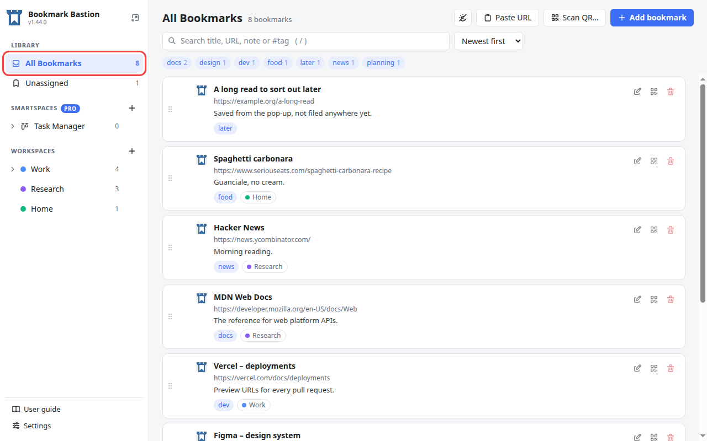

Look at the small coloured chips at the end of each card: they say which workspaces use that bookmark. Click a chip to open that workspace.

### Unassigned: the inbox

A bookmark doesn't have to be in a workspace. **Unassigned** shows the ones that are in none, which makes it a handy inbox: save first, sort later.

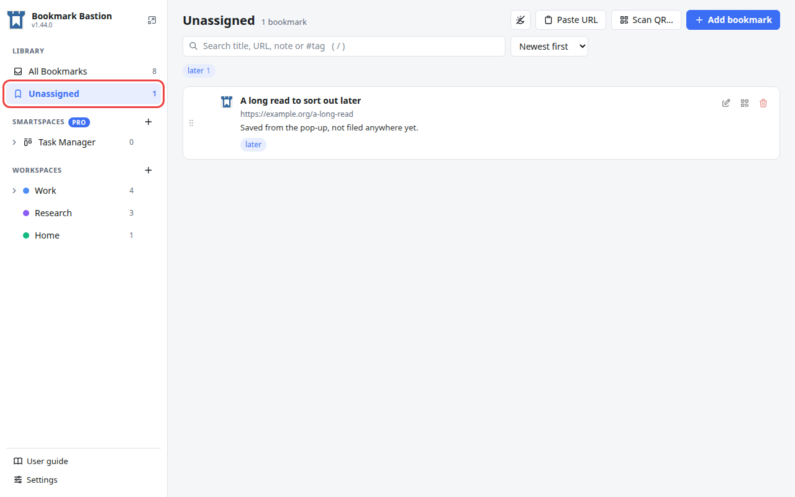

## 2. Workspaces: lists of references

A **workspace** is a named, coloured list for one purpose: *Work*, *Research*, *Home*. Workspaces are listed in the sidebar under **Workspaces**, each with a colour dot and the number of bookmarks it holds. Click one to open it.

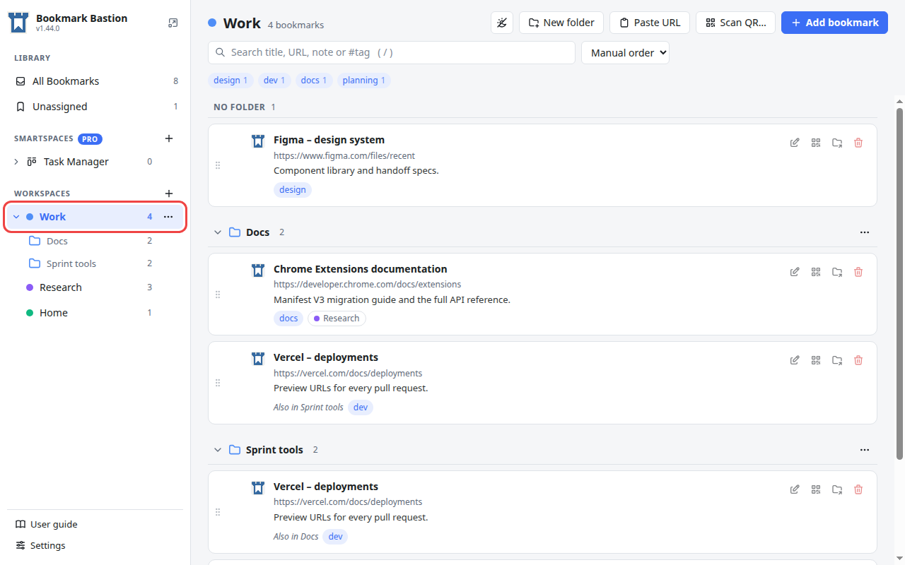

What makes a workspace different from an ordinary folder is that it only holds **references**:

- The same bookmark can be in **any number of workspaces**. In the example, *Chrome Extensions documentation* is in both **Work** and **Research**. It was saved once.
- Edit its title, note or tags in one place and **every workspace shows the change**. There is no second copy to keep up to date.
- Taking a bookmark out of a workspace only removes the reference. The bookmark stays in the bucket and in your other workspaces.

## 3. Folders: sections inside a workspace

A workspace can be split into **folders** to keep a long list tidy. In the picture above, **Work** has two folders, *Docs* and *Sprint tools*, plus a **No folder** section for bookmarks that aren't in either.

Folders follow a few simple rules:

- A folder belongs to **one workspace**. *Docs* in Work has nothing to do with a folder of the same name in another workspace.
- Folders are **one level deep**: a folder can't contain another folder.
- Folders only arrange what is already in the workspace. They don't change which workspaces a bookmark belongs to, or how many bookmarks the workspace has.
- Folders are listed alphabetically, and **No folder** always comes first.

Click a folder in the sidebar to see only that folder. The title shows the path, *Work › Docs*.

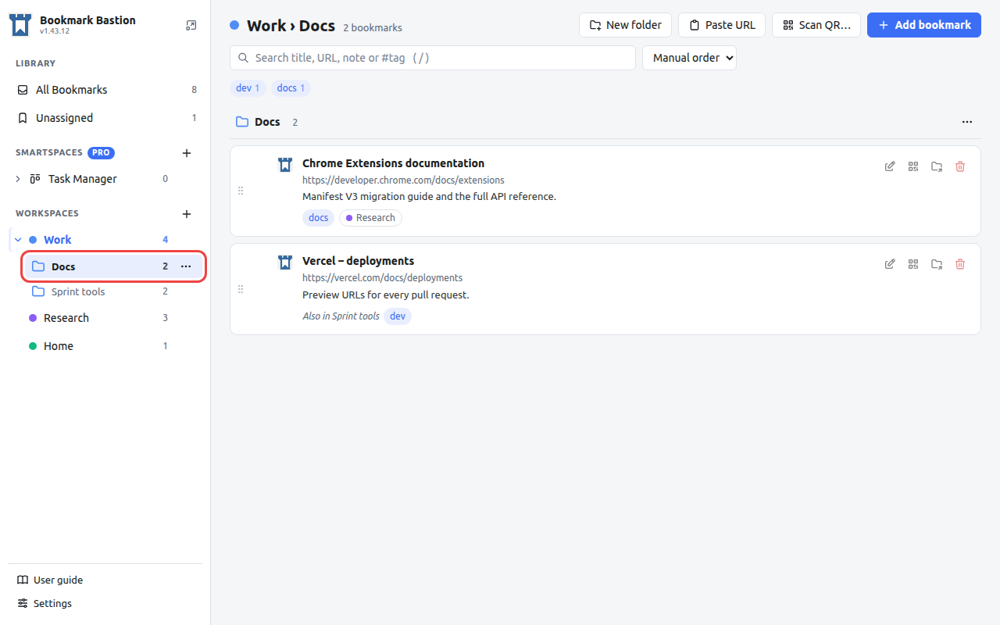

### The same bookmark in several folders

A bookmark can also sit in **several folders of the same workspace** at once. *Vercel – deployments* is in both *Docs* and *Sprint tools*. It is one bookmark with one note and one set of tags. Each place it appears says **Also in** and names the other one.

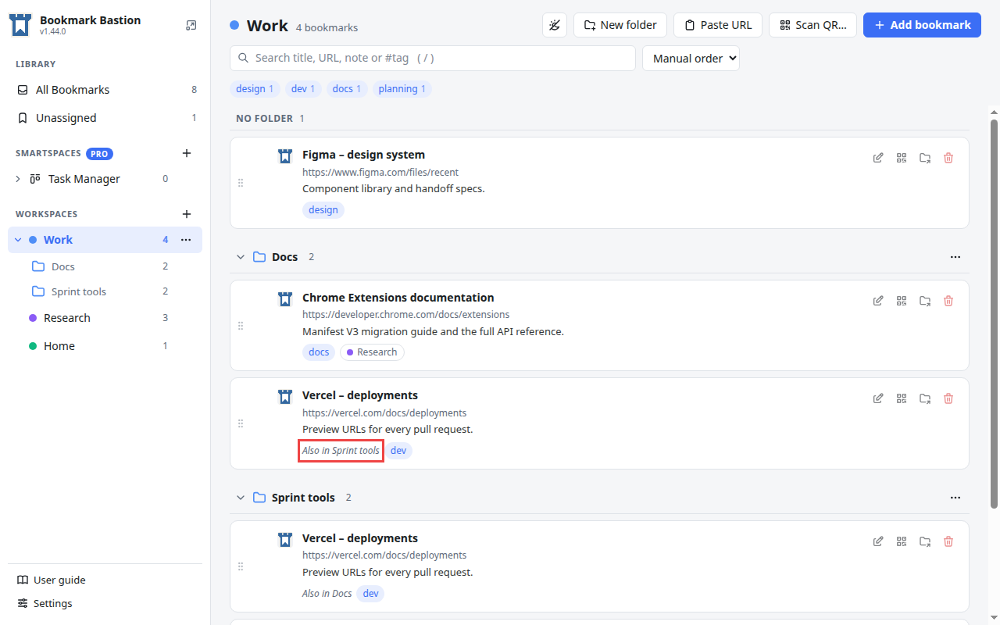

## 4. How the three relate

| | Bucket | Workspace | Folder |
| --- | --- | --- | --- |
| What it is | Everything you saved | A list for one purpose | A section of one workspace |
| What it holds | The bookmarks themselves | References to bookmarks | References, from its workspace |
| How many bookmarks can it hold | All of them, once each | Any | Any from its workspace |
| Can a bookmark be in several? | Always exactly one | Yes, in as many as you like | Yes, in several of the same workspace |
| Where it is in the sidebar | **All Bookmarks** | Under **Workspaces** | Under its workspace |

Two sentences to remember:

1. **A bookmark exists once. Workspaces and folders are only ways of looking at it.**
2. **A bookmark can be in a workspace without being in a folder, and in several workspaces and folders at the same time.**

## 5. Choosing where a bookmark belongs

Press the pencil on a card to open **Edit bookmark** and scroll to **Workspaces**. Tick each workspace the bookmark belongs to. Under every ticked workspace that has folders, toggles appear for **No folder** and for each folder: tick as many as you like.

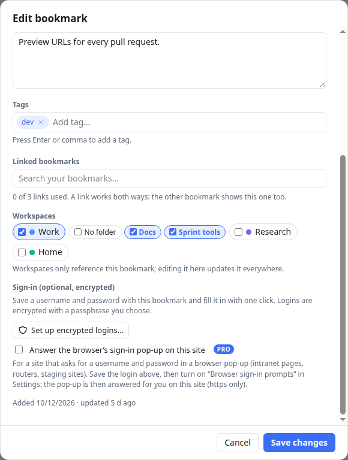

In this picture the bookmark is in **Work**, in both of its folders, and not in **Research** or **Home**. Un-ticking a workspace removes the bookmark from it.

You can also move a bookmark by dragging its card onto a workspace or a folder in the sidebar, or with the **Move to…** button on the card.

## 6. Making a workspace and a folder

**A workspace:** press **+** next to *Workspaces* in the sidebar, give it a name and pick a colour (a named one, or any custom colour), then press **Create workspace**.

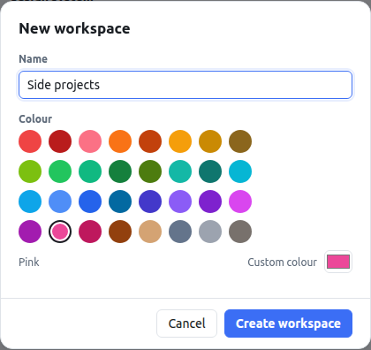

**A folder:** open a workspace and press **New folder** in the toolbar. Give it a name and, if you like, an icon. The folder takes the colour of its workspace.

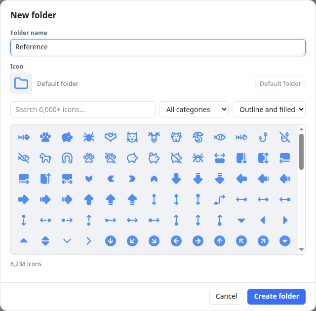

## 7. Remove or delete: two different things

Because a bookmark exists once and workspaces only reference it, there are two ways to get rid of something, and the app always asks which you mean.

Inside a workspace, the trash button on a card removes **only the place you pressed it on**. If the bookmark is also in other folders of the same workspace, those stay. For *Vercel – deployments*, which is in both *Docs* and *Sprint tools*, the trash button on its *Docs* card asks **Remove from "Docs"?** and removes just that one:

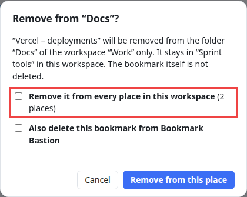

If you do want it out of every place in the workspace, tick **Remove it from every place in this workspace**. It is never ticked for you.

When the card is the bookmark's **only** place in the workspace, there is nothing else to keep, so the window asks **Remove from "Work"?** and the bookmark leaves the workspace. Either way the bookmark stays in All Bookmarks and in your other workspaces.

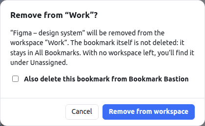

To delete the bookmark itself, tick **Also delete this bookmark from Bookmark Bastion**. The window changes to **Delete bookmark everywhere?** and tells you which workspaces lose it. This can't be undone.

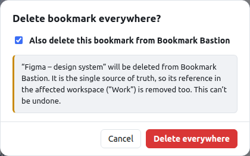

Cancel, Esc, or a click outside the window leaves everything as it was.

| You do this | What happens |
| --- | --- |
| Remove a bookmark from a workspace (trash button on a card) | Only that place goes. If the bookmark is also in other folders of the workspace, it stays there; tick the extra box to remove every place. It stays in All Bookmarks and in your other workspaces. You can undo it. |
| Delete a bookmark | The bookmark and all its references go, and so does its saved login. This can't be undone. |
| Delete a workspace | The workspace and its folders go. **Its bookmarks are never deleted**: they stay in All Bookmarks. |
| Delete a folder | Only the folder goes. Its bookmarks stay in the workspace, under **No folder**. |

## Limits worth knowing

- A workspace name can be up to 60 characters and must be unique. A folder name must be unique within its workspace, and a workspace can have up to 50 folders.
- A folder can't contain another folder. If you need more structure than that, use a second workspace.
- The same page is only ever saved once: saving an address you already have finds the existing bookmark instead of making a copy.

For every detail, see the [user guide](../USER-GUIDE.md) (*Key concepts*, *Workspaces* and *Folders*). To turn on Pro, see [how to activate Bookmark Bastion Pro](activate-bookmark-bastion.md).
