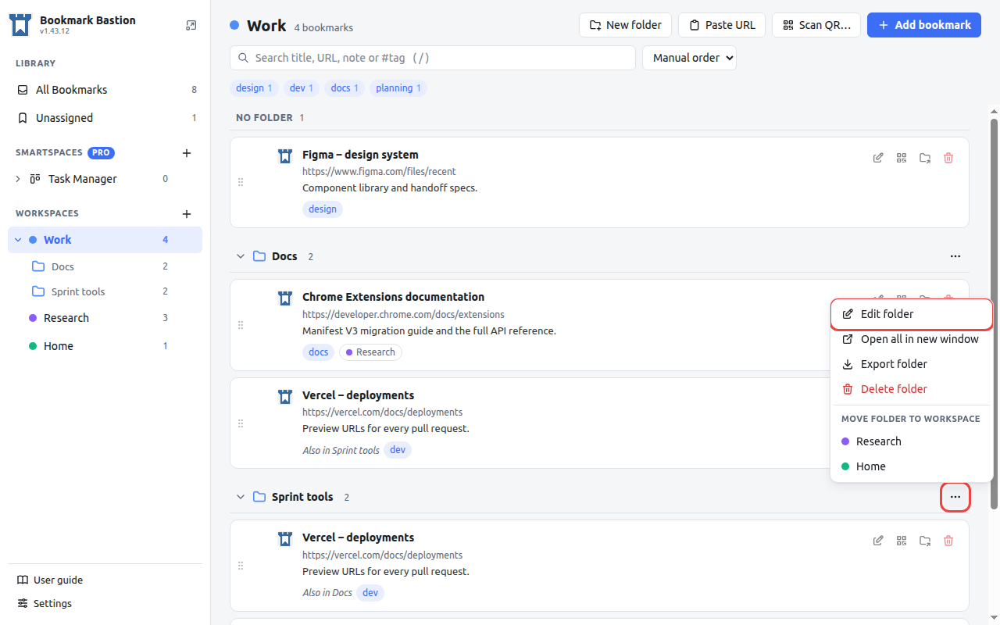
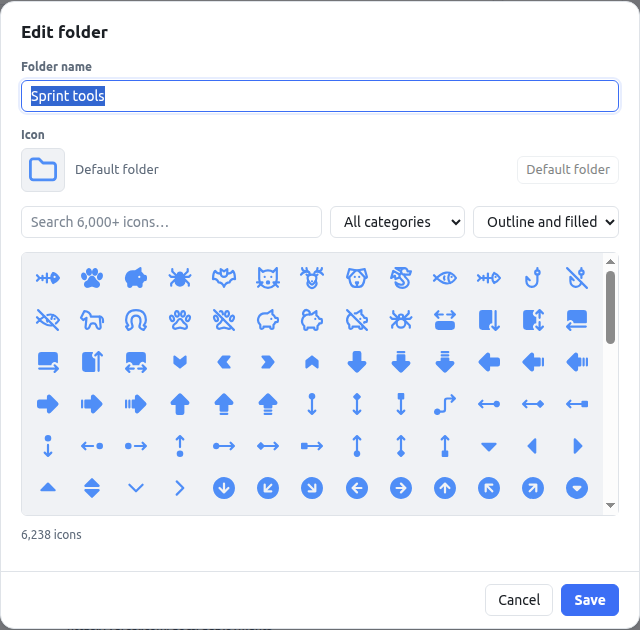
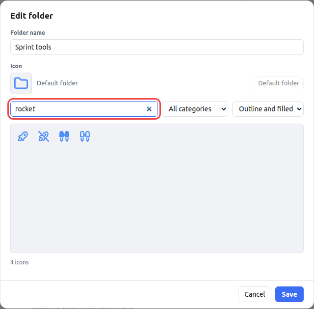
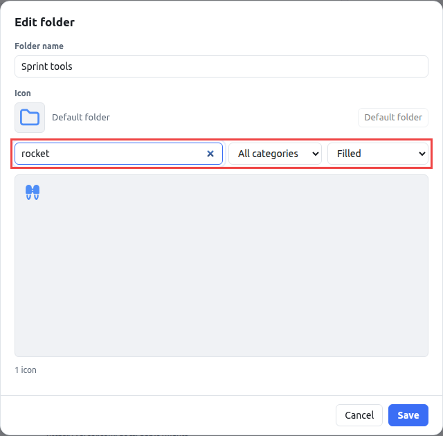
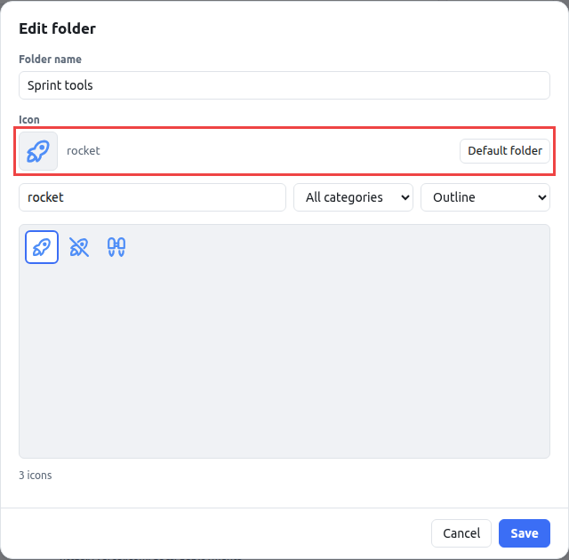
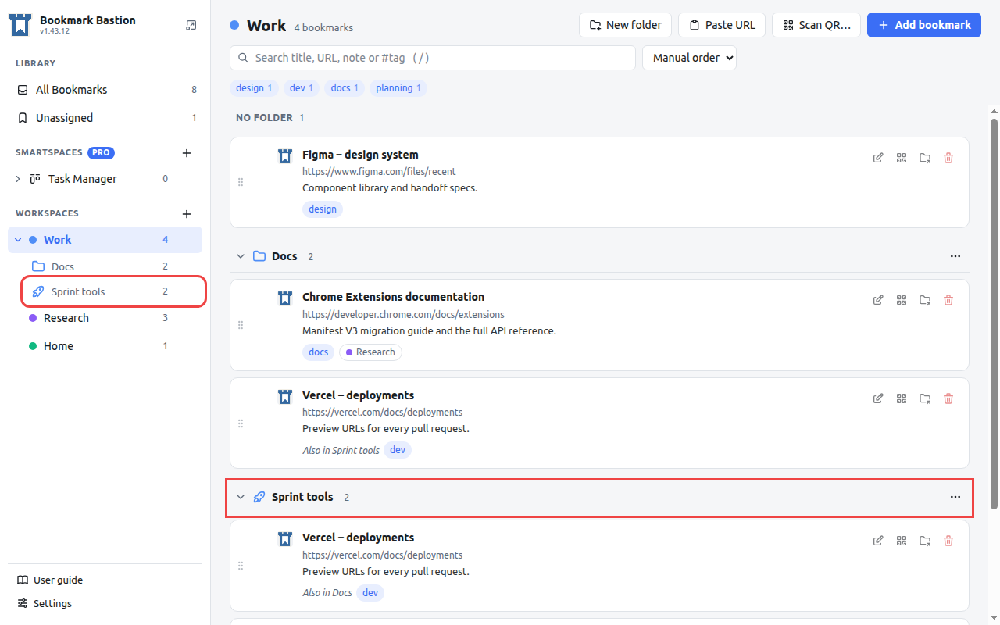
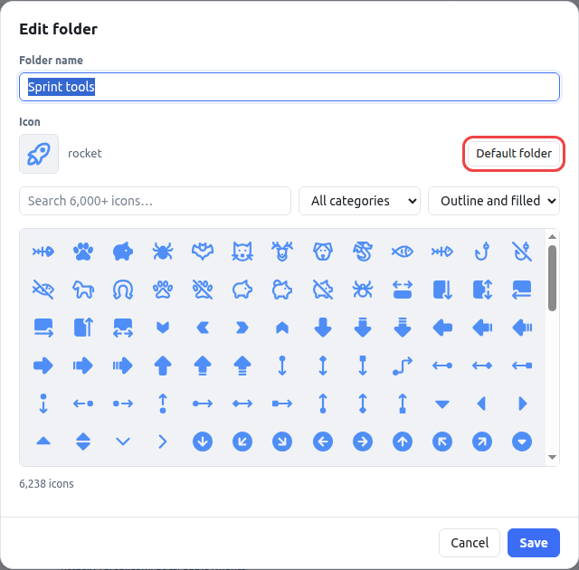

# How to change the icon of a folder

Every folder starts with the same plain folder icon. When a workspace has a lot of folders, giving each one its own picture (a rocket for *Sprint tools*, a coin for *Billing*, a book for *Reading*) makes them much quicker to tell apart, both in the sidebar and above the bookmarks.

This tutorial changes the icon of the folder **Sprint tools** in the workspace **Work**, and takes about a minute. It works the same for every folder.

> New to folders? [Bookmarks, workspaces and folders: how they fit together](bookmarks-workspaces-folders.md) explains what a folder is.

## 1. Open the folder's menu

Open the workspace that holds the folder. Above the folder's bookmarks, press the **⋯** button at the right end of the folder's header (its name is *Folder options for Sprint tools*), then choose **Edit folder**.

There are two other ways to the same menu:

- Right-click the folder's header.
- In the sidebar, hover the folder under its workspace and press its **⋯**, or right-click it.

## 2. The Edit folder window

The window shows the folder's **name** and, under **Icon**, the current icon. A folder that has never been changed says **Default folder**. Below that is a search box, two lists to narrow the search, and a grid of more than 6,000 icons.

## 3. Search for an icon

Type what you are looking for in **Search icons**. The grid fills with the icons that match as you type. Search by the name of the thing (*rocket*) or by a topic (*money*, *server*, *music*): each icon is found by the words that describe it, not only by its own name.

Hover an icon to see its name. The line under the grid says how many icons match.

## 4. Narrow it down (optional)

Two lists next to the search box help when there are too many results:

- **Category** limits the search to one group of icons, such as *Animals* or *Buildings*.
- **Style** chooses **Outline** (line drawings), **Filled** (solid shapes) or both. Using one style for all your folders makes them look consistent.

## 5. Pick the icon

Click the icon you want. It appears at the top of the **Icon** section together with its name, so you can see it before you save. Click a different one to change your mind.

Press **Save**.

## 6. The result

The folder now shows its new icon in the sidebar and above its bookmarks. The icon is drawn in the **colour of the workspace**, so if you change the workspace's colour, all its folder icons change with it.

## Going back to the plain folder

Open **Edit folder** again and press **Default folder** next to the icon, then **Save**.

## Good to know

- **Changing the icon changes nothing else.** The folder keeps its name and its bookmarks.
- **Each folder has its own icon.** Folders with the same name in different workspaces are different folders.
- **Icons travel with your library.** They are included when you export a workspace, a folder or the whole library, and come back when you import it.
- **Rename and re-icon in one go.** The same window changes the folder's name. Press **Save** once for both.
- **The icons** come from the open-source Tabler Icons set.

To create a folder with an icon from the start, press **New folder** in the workspace's toolbar: the window is the same one, with the same icon picker.
