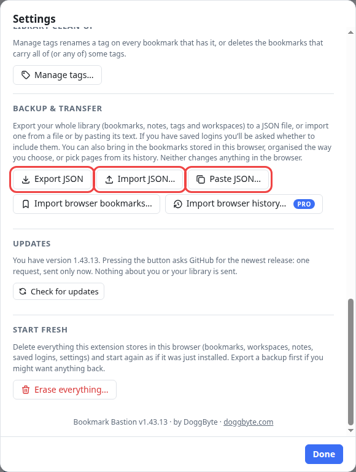
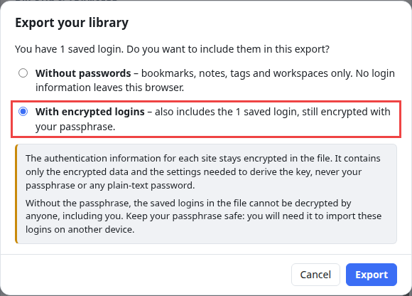
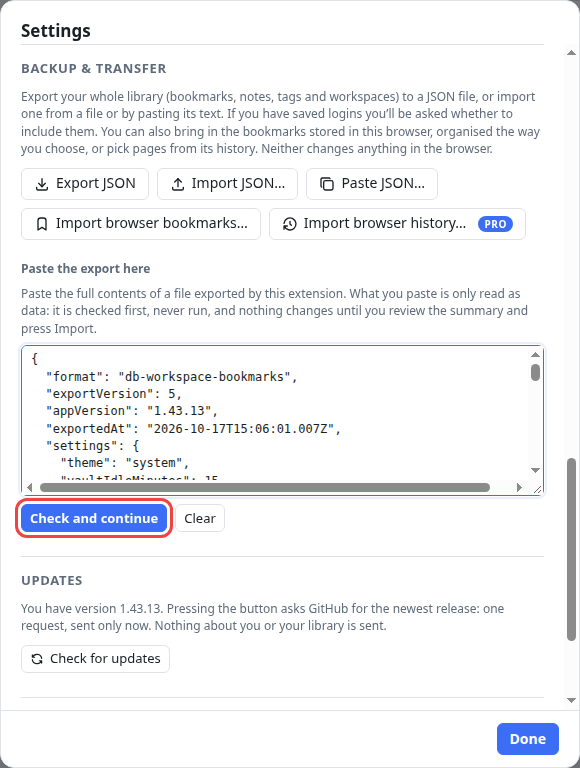
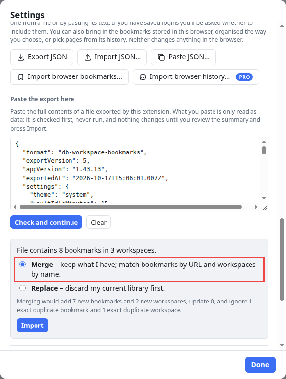
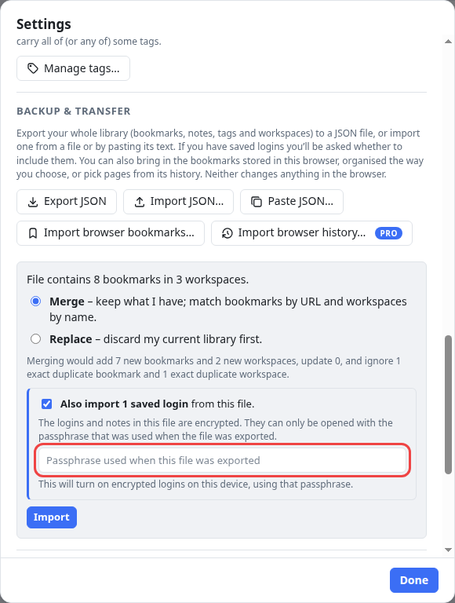
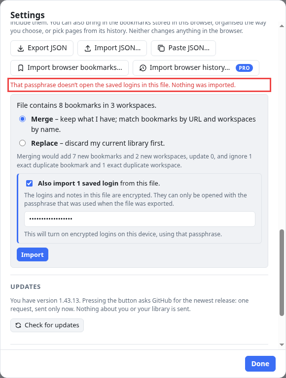
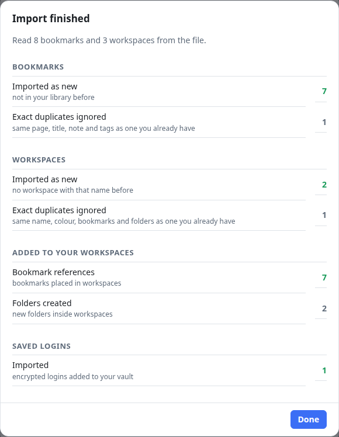

# How to export and import your bookmarks

Bookmark Bastion keeps your library in your browser. To make a **backup**, or to **move your bookmarks to another computer or browser**, you export them to a file and import that file where you want them.

This tutorial covers the three buttons in **Settings → Backup & transfer**:

| Button | What it does |
| --- | --- |
| **Export JSON** | Saves your library as a file. |
| **Import JSON…** | Brings in a file you saved earlier. |
| **Paste JSON…** | The same as Import JSON…, but you paste the text of the file instead of choosing it. |

It also explains the **passphrase**: when your library has saved logins, it decides whether those travel with the file, and it is what opens them on the other side.

To get there, open the manager and press **Settings** at the bottom of the sidebar, then scroll to **Backup & transfer**.

## Export JSON

Press **Export JSON**. The file is saved by your browser, like any download, with a name such as `bookmark-bastion-2026-10-17.json`.

The file holds your **whole library**: bookmarks with their descriptions, notes, tags and links, your workspaces and folders (with the folders' icons), and your settings. It does **not** hold your Pro license key. You enter that again on the new computer.

### If you have saved logins: the passphrase option

When your library has **saved logins or locked notes**, Export JSON first asks whether to include them. This is the passphrase option:

- **Without passwords** (the default) saves bookmarks, notes, tags and workspaces only. **No login information leaves your browser.** Bookmarks with a locked note are exported without that note.
- **With encrypted logins** also puts your saved logins and locked notes in the file, **still encrypted**. The file contains only the encrypted data and the settings needed to derive the key, never your passphrase or any plain-text password.

> **Keep your passphrase safe.** The logins in the file can only be opened with the passphrase you had when you exported. Without it, nobody can open them, including you, and there is no recovery. You need it to import them on another computer.

Press **Export**. A message confirms what was saved and reminds you of the passphrase:

A file that includes logins has **with-logins** in its name (`bookmark-bastion-2026-10-17-with-logins.json`), so you can tell it apart from one that doesn't.

If you have no saved logins, Export JSON doesn't ask anything: it saves the file straight away.

> **The file itself is plain text.** Bookmarks, titles, notes and tags in an export can be read by anyone who gets the file, even if your library is encrypted. Only the logins are encrypted. Keep your exports somewhere safe.

### Exporting only a part

To save just one workspace, use **Export workspace** in the workspace's **⋯** menu. For one folder, use **Export folder** in the folder's menu. The file has the same format, but holds only that part (and only the saved logins of its bookmarks, if you choose to include them).

## Import JSON…

Press **Import JSON…** and choose a file you exported. Nothing is changed yet: first you get a **review** that shows what is in the file.

If you would rather paste than choose a file, use the next section. Both end up at the same review.

## Paste JSON…

Press **Paste JSON…**. A box opens: paste the **full contents** of an exported file into it, then press **Check and continue**.

This is handy when you can copy text but not move a file, for example between two computers that share a clipboard, or when a file is open in a text editor. What you paste is **only read as data**: it is checked first and never run, and the box is cleared after the import. **Clear** empties it without importing anything.

## The review: check it, then press Import

After you choose a file, or press **Check and continue**, a review appears in Settings:

It tells you what the file contains (here, 8 bookmarks in 3 workspaces) and lets you choose **how** to bring it in:

| Choice | What it does |
| --- | --- |
| **Merge** (the default) | **Keeps everything you have** and adds what is new. Bookmarks are matched by web address and workspaces by name. Your existing titles and notes are never overwritten, and tags are combined. |
| **Replace** | **Discards your current library** and adopts the file, including its settings. You are asked to confirm first. |

The line under the choices works out what a merge would do to *your* library before you commit: here it would add 7 new bookmarks and 2 new workspaces, and ignore 1 exact duplicate bookmark and 1 exact duplicate workspace. **Exact duplicates are never imported twice**, so importing the same file again, or your own export, changes nothing.

Nothing has changed until you press **Import**. Not sure? Close Settings and nothing happens.

> **Before you choose Replace,** export your current library first, so you can get back to it.

## The passphrase when you import

If the file has saved logins in it, the review adds a box:

Type **the passphrase you had when you exported the file**, then press **Import**. What happens next depends on the computer you are importing to:

- **A computer with no saved logins set up yet:** the passphrase in the file becomes the passphrase of the new, encrypted logins. The review says so.
- **A computer where you already use saved logins, with a different passphrase:** you unlock your own saved logins first, and the imported logins are encrypted again with **your** passphrase.
- **Your own passphrase, on the same computer:** nothing more to type if your logins are already unlocked.

Don't want the logins? **Untick "Also import…"** and only the bookmarks come in.

### If the passphrase is wrong

A wrong passphrase is harmless. You get a message, and **nothing at all is imported**: no bookmarks and no logins. Try again with the right one.

Forgotten it? You can still import the **bookmarks**: untick **Also import…** and import without the logins.

## The report

When the import is done, a report shows what happened:

It counts what was **imported as new**, which **exact duplicates were ignored**, which existing items were **updated**, and, for saved logins, how many were imported. Press **Done**.

## Moving to another computer

1. On the old computer: **Settings → Backup & transfer → Export JSON**. Choose **With encrypted logins** if you want your logins too, and **write down your passphrase**.
2. Copy the file to the new computer (a USB drive, a cloud folder, anything).
3. Install Bookmark Bastion on the new computer.
4. **Settings → Backup & transfer → Import JSON…**, choose the file, keep **Merge**, type the passphrase if the file has logins, and press **Import**.
5. Enter your Pro license key again, if you have one (**Settings → Bookmark Bastion Pro**).

## Good to know

- **A file is checked before anything happens.** It must be one of this extension's own files, not from a newer incompatible version, and it must be well formed. If anything is wrong the whole file is refused and the message names the first problem, so a half-understood file is never partly imported. Web addresses that could run code (such as `javascript:` ones) are skipped and counted.
- **Size limits:** a file can hold up to 10 MB of text, 50,000 bookmarks and 500 workspaces.
- **Import never makes duplicates.** A page you already have is matched by its address, so it is reused instead of copied.
- **A different button for your browser's own bookmarks.** *Import browser bookmarks…* next to these three buttons brings in the bookmarks stored in the browser, organised the way you choose. It is a different feature: see the [user guide](../USER-GUIDE.md).

New to workspaces and folders? [Bookmarks, workspaces and folders: how they fit together](bookmarks-workspaces-folders.md) explains what an export holds. For saved logins, see [how to save a username and password on a bookmark](save-a-login-and-sign-in.md).
