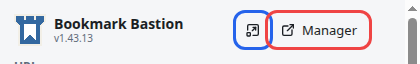
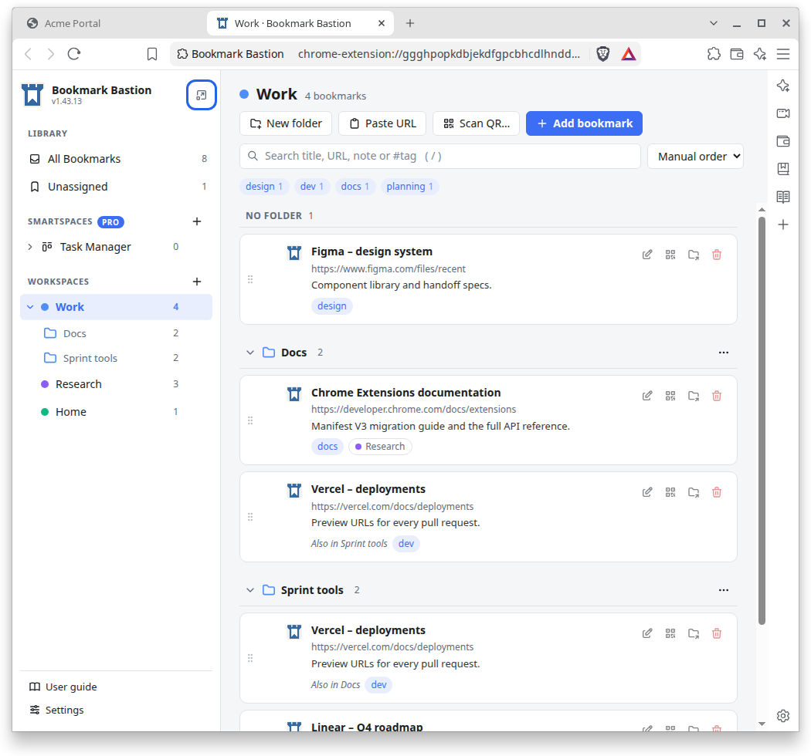
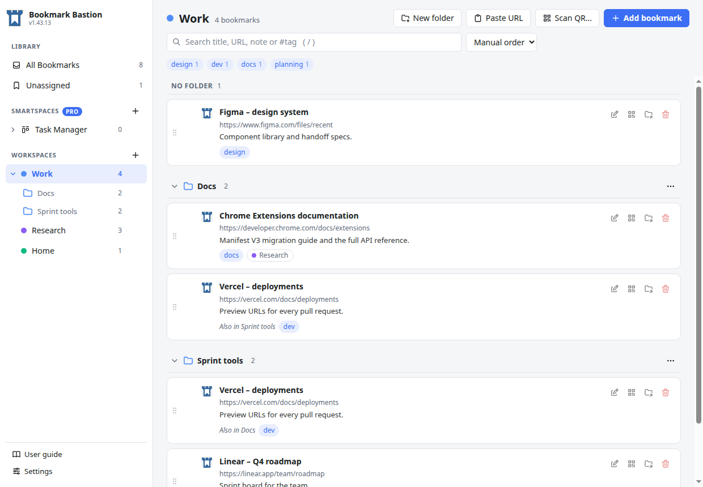
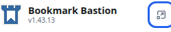

# Three ways to open the manager

The **manager** is the full view of your library: the sidebar with your workspaces and folders, the list of bookmarks, search, settings and the user guide. The small **pop-up** on the toolbar is for saving the page you are on; the manager is where you organise everything.

You can open the manager in three ways. The first opens it in a **browser tab**; the other two open it in **its own window**:

| | Way 1 | Way 2 | Way 3 |
| --- | --- | --- | --- |
| How | Press **Manager** in the pop-up | Press the **pop-out icon** in the pop-up | Press the **pop-out icon** in the sidebar of the manager, once it is open |
| Where it opens | A new tab in your browser window | A separate window with **no tabs and no address bar** | The same kind of window; the manager's tab closes |
| Good for | Normal use: it sits among your other tabs | Keeping it **beside** the site you are working on | Moving a manager you already have open into its own window |

All three show the **same library**. Whatever you do in one appears in the other straight away, so it never matters which way you used.

## Start from the pop-up

Click the Bookmark Bastion button in your browser's toolbar (the puzzle-piece menu lists it if you haven't pinned it). The top right of the pop-up has two buttons for the manager. The red one is **Manager**, and the blue one beside it is the **pop-out icon**.

## Way 1: open it in a browser tab

Press **Manager** (the red one). The manager opens in a **new tab** of your current browser window, and the pop-up closes.

It behaves like any other tab: switch to it with the tab strip or your browser's tab shortcuts, and close it when you are done. If you press **Manager** again while it is already open, you are taken to that tab instead of getting a second one.

## Way 2: open it in its own window, from the pop-up

Press the **pop-out icon** (the blue one beside *Manager*). The manager opens in **its own window**, with no tab strip and no address bar, so there is nothing but the manager in it.

Pressing the icon again while the window is open **brings that window to the front** instead of opening another one.

Because it is a separate window, you can put it **next to your browser** and see both at once: keep your workspaces in view while you read a page, or drag a link, or the address of a tab, from the browser into the manager to save it.

## Way 3: from the manager itself, with the icon in the sidebar

If the manager is **already open in a tab**, you don't have to go back to the pop-up. At the very top of the manager's sidebar, **to the right of the title** *Bookmark Bastion*, there is the same **pop-out icon**.

Press it, and the manager **moves out of the tab into its own window**, the same window as in Way 2. The tab closes, so you never end up with the manager open twice. This is the quickest way to change your mind: open it in a tab first, and pop it out when you want it beside your work.

The same icon is in the sidebar of the manager window too. Pressing it there brings that window to the front.

## Which should I use?

- **A tab** (Way 1) is the simplest. Use it when you open the manager now and then to find or organise something.
- **Its own window** (Way 2, or Way 3 from a manager that is already open) is better when you want the manager to stay open all day beside your work, or on a second screen.

You can switch whenever you like. To go from a window back to a tab, close the window and press **Manager** in the pop-up again.

## Good to know

- **Your library is the same either way.** There is only one library, and every way opens the same manager. Two managers open at once update each other live.
- **The manager is also the extension's options page.** On your browser's extensions page, the extension's *Extension options* opens it in a tab, just like **Manager**.
- **Settings and the user guide** are at the bottom of the manager's sidebar, in a tab or in its own window.

New to the manager? [Bookmarks, workspaces and folders: how they fit together](bookmarks-workspaces-folders.md) explains what you see in it.
