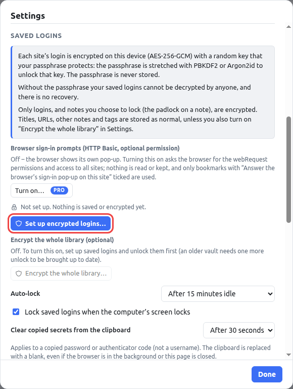
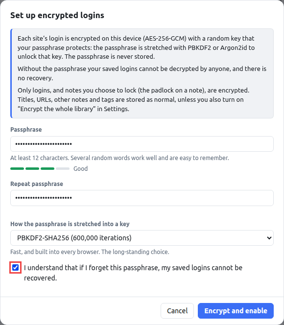
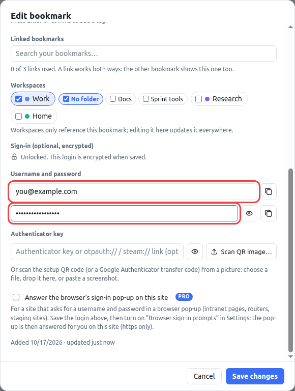
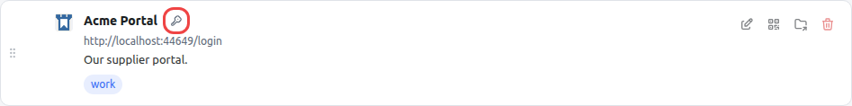
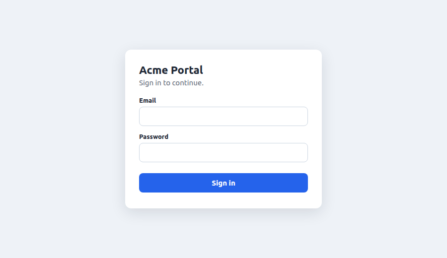
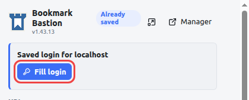
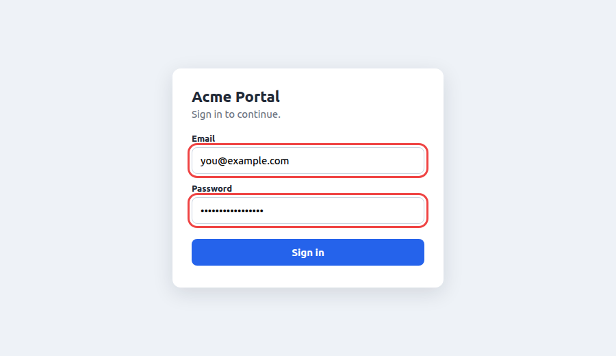

# How to save a username and password on a bookmark and use it to sign in

A bookmark can remember the **username and password** for its website and fill them in for you when the site asks you to sign in. The login is **encrypted on your computer** with a passphrase that only you know, and it is filled in only when you ask: the extension never signs you in on its own.

This tutorial has two parts:

1. **Save a login on a bookmark** (the first time, this includes a one-off setup of the encryption).
2. **Use it** to fill a sign-in page.

In the pictures, the site is a made-up demo page called *Acme Portal* running on the same computer, and the username and password are made up too.

> **Free and Pro.** The free version keeps up to **5** saved logins. Pro has no limit. A login you already have can always be used and changed.

## Part 1: Save a login on a bookmark

### 1. Set up encrypted logins (once)

Until you do this, nothing is stored or encrypted and the extension behaves as it always did. In the manager, press **Settings** at the bottom of the sidebar, find **Saved logins** and press **Set up encrypted logins…**.

### 2. Choose a passphrase

In the window that opens:

1. Type a **passphrase of at least 12 characters**. Several random words are strong and easy to remember (*blue-harbour-lantern-42* is the kind of thing that works). A strength meter shows how good it is.
2. Type it again under **Repeat passphrase**.
3. Tick **I understand that if I forget this passphrase, my saved logins cannot be recovered.**
4. Press **Encrypt and enable**.

> **Read this before you continue.** Your passphrase is **never stored anywhere**. Without it, nobody can decrypt your saved logins, not even the author of the extension, and there is **no recovery**. If you forget it, the only way out is to delete the saved logins and start again. Write it down somewhere safe.

When it is done, press **Done**. Your logins are now unlocked for this session.

You can leave the *How the passphrase is stretched into a key* list as it is. The default is built into every browser and is a good choice.

### 3. Add the username and password to the bookmark

Find the bookmark of the site you sign in to. If you don't have one yet, press **Add bookmark** and save the sign-in page's address first. Then press the pencil on its card to open **Edit bookmark** and scroll to **Sign-in (optional, encrypted)**.

Type the **username or email** and the **password**. The password is hidden as you type. The eye button next to it shows it for a moment, and the copy button copies it.

Press **Save changes**.

### 4. Check the key

A small **key icon** now sits next to the bookmark's title. It means a login is saved for that bookmark.

Only the username and password are encrypted. The title, address and tags are stored as usual, so you can still search for the bookmark.

## Part 2: Sign in to the website

### 5. Open the sign-in page

Go to the site's sign-in page the usual way, for example by clicking the bookmark.

### 6. Press Fill login

Click the Bookmark Bastion button in your browser's toolbar. When a bookmark with a saved login matches the page, a **Saved login for** *the site* card appears at the top of the pop-up. Press **Fill login**.

If your saved logins are **locked** (see [Locking and unlocking](#locking-and-unlocking) below), the button says **Unlock and fill** and asks for your passphrase first. If more than one bookmark matches the page, there is one **Fill:** *title* button for each.

> **Faster:** press **Alt+Shift+L** to fill the page without opening the pop-up.

### 7. Check the form and sign in yourself

The username and password are now in the boxes, and the password is still hidden. The extension **never presses Sign in for you**: look the form over, then press the site's own button.

The toolbar button briefly shows what happened:

| Badge | Meaning |
| --- | --- |
| ✓ (green) | The login was filled. |
| **1/2** (amber) | Only the username was filled. The password will be filled when its screen appears (see below). |
| **?** (amber) | No saved login matches this page. |
| **LOCK** (amber) | Your saved logins are locked. Unlock them from the pop-up or the manager first. |
| **!** (red) | The form could not be filled. |

## Sites that ask for the password on a second screen

Some sites ask for the username first and the password on the next screen. Press **Fill login**, then the page's **Next**: the extension watches that page for up to 90 seconds, and fills the password when its screen appears. If a verification-code screen follows and the login has an authenticator key, that is filled too. It still never signs you in, and you press the site's buttons yourself.

## Locking and unlocking

Your saved logins lock by themselves after **15 minutes** without use (you can change this in Settings) and when your computer's screen locks. The toolbar icon then shows a small **padlock**. To use a login again, press **Unlock and fill** in the pop-up, or **Unlock Logins & Notes** at the bottom of the manager's sidebar, and type your passphrase. You can also lock them yourself with **Lock Logins & Notes** in the same place.

## When nothing is offered

- **The pop-up shows no login card, or the badge shows ?** The bookmark's address must be on **exactly the same site** as the page you are on, with the same `https`/`http`, the same name and the same port. A login saved for `example.com` is not offered on `app.example.com` or `www.example.com`. Edit the bookmark's address if the site sign-in lives somewhere else.
- **The pop-up says the page isn't using HTTPS.** Logins are never filled on plain `http://` pages, because the password would cross the network unprotected. The only exception is a site on your own computer (`localhost`).
- **The form was not filled (the badge shows !).** Some sites build their sign-in form in an unusual way. Press **Fill login** again once the form is fully visible: only boxes you can actually see are filled.
- **The badge shows LOCK.** Unlock your saved logins first.

## Why this is safe to use

- **Encrypted on your device.** Each login is encrypted with a random key that your passphrase protects. Neither the passphrase nor the key is ever stored or sent anywhere.
- **Only the exact site.** A login is only ever offered on the exact site it was saved for, and it never reaches frames of other sites embedded in that page.
- **Only when you ask.** Nothing is filled when a page loads, and the extension has no standing access to any website. It can only act on the page you are looking at, at the moment you press the button or the shortcut.
- **Never submitted.** You always press the site's own Sign in button yourself.

## Going further

- **Two-factor codes.** A login can also hold the key of an authenticator app, so the six-digit code is filled in for you too. See *Two-factor codes* in the [user guide](../USER-GUIDE.md).
- **Back up your logins.** They can be exported and imported with the rest of your library. See *Exporting and importing logins* in the user guide.
- **Changing the passphrase.** *Settings → Saved logins* lets you choose a new passphrase without re-entering your logins.
- **Pro.** Without a license you can keep up to 5 saved logins. See [how to activate Bookmark Bastion Pro](activate-bookmark-bastion.md).
