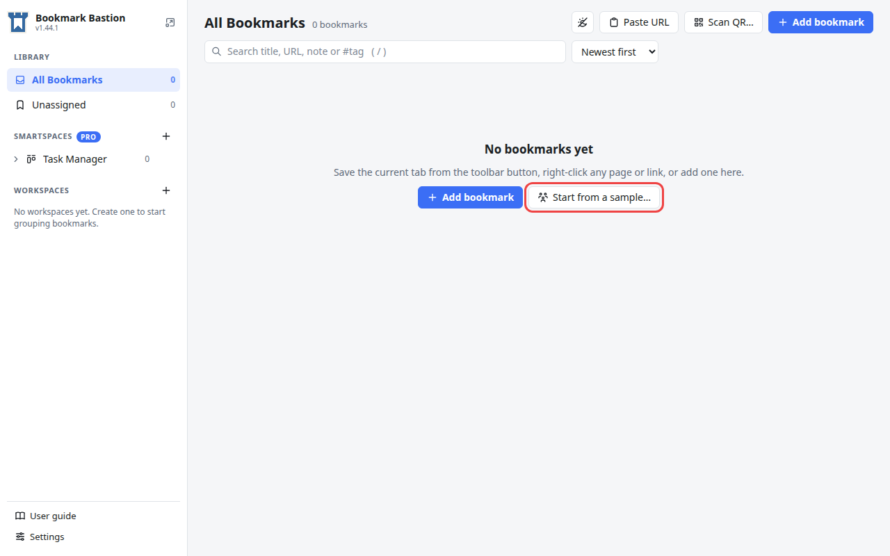
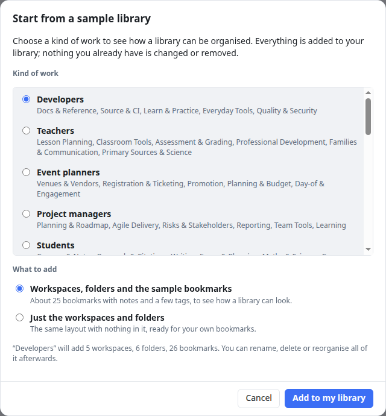
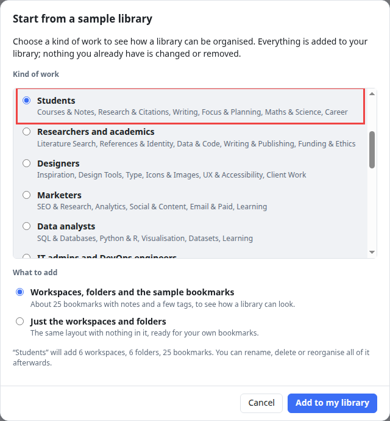
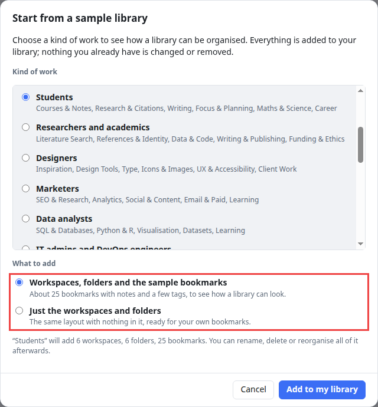
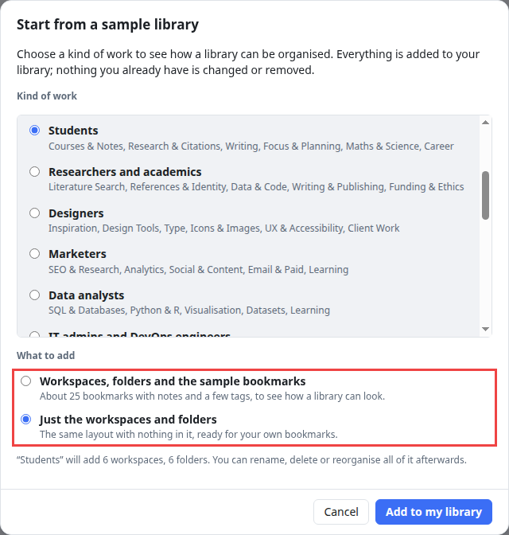
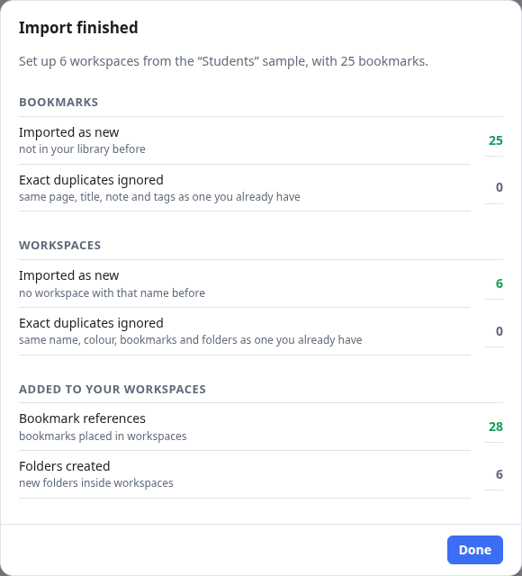
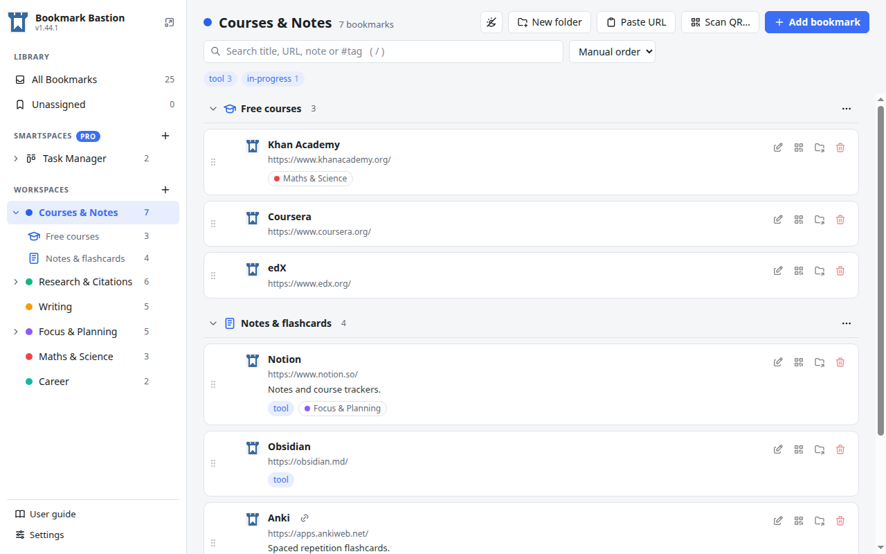
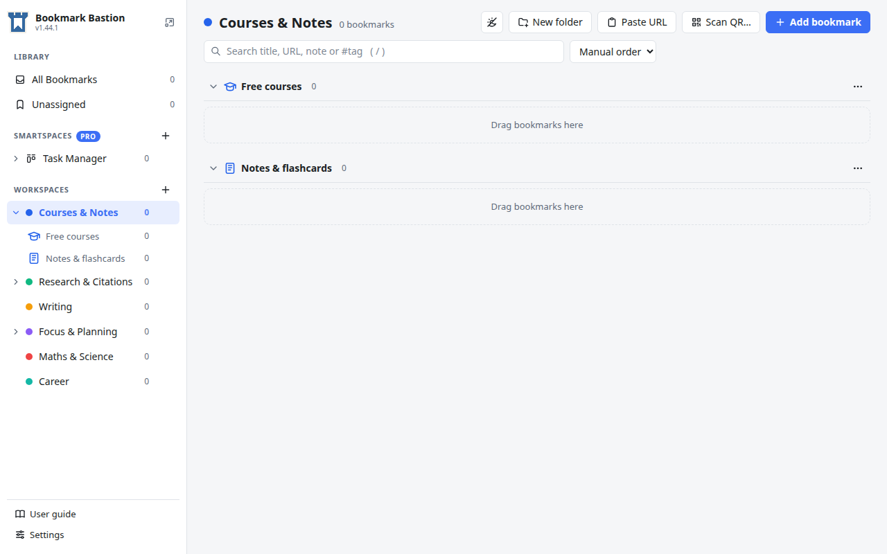

# How to start with a sample library for your kind of work

A blank library is hard to picture. Bookmark Bastion can fill an **empty** library with a ready-made one for a **kind of work**: a set of workspaces, with folders and, if you want them, about 25 example bookmarks with notes and tags. You see how a well-organised library looks, and then rename, delete or rearrange whatever you like.

This tutorial picks the **Students** sample. It works the same for the other nineteen, and it takes about a minute.

> A sample is **always added** to your library. It never replaces anything, and nothing you already have is changed or removed. The sample bookmarks are made-up examples of well-known sites; the samples contain no saved logins.

## 1. Start from an empty library

The offer appears on the **empty screen** of a library with no bookmarks at all (*All Bookmarks*, or an empty workspace), next to **Add bookmark**. Press **Start from a sample…**.

> Don't see the button? It only shows while the library has nothing in it. Once you have saved a bookmark the offer is gone, because a sample is meant for starting out. (If you want to bring in the bookmarks you already keep in your browser instead, use **Settings → Backup & transfer → Import browser bookmarks…**.)

## 2. Pick a kind of work

A window lists **twenty kinds of work**: developers, teachers, event planners, project managers, students, researchers and academics, designers, marketers, data analysts, IT admins and DevOps engineers, writers and content creators, freelancers and consultants, job seekers, journalists, small business owners and entrepreneurs, sales professionals, HR and recruiters, photographers and video creators, personal finance and home, and healthcare professionals.

Under each name, in grey, are the **workspaces** that sample would create. Scroll the list and choose the one closest to what you do. Here we choose **Students**: its workspaces are *Courses & Notes*, *Research & Citations*, *Writing*, *Focus & Planning*, *Maths & Science* and *Career*.

## 3. Choose what to add

Under **What to add**, pick one of two things:

| Choice | What you get |
| --- | --- |
| **Workspaces, folders and the sample bookmarks** (the default) | The workspaces and folders **and** about 25 bookmarks with notes and a few tags, already placed in them. The best choice for seeing how everything fits together. |
| **Just the workspaces and folders** | The same layout with **nothing in it**, ready for your own bookmarks. The best choice when the structure suits you and you want to fill it yourself. |

The grey line under the choices says **exactly what you would get**, for example *"Students" will add 6 workspaces, 6 folders, 25 bookmarks.* It changes as you pick, so you can check before you commit. With **Just the workspaces and folders** it reads *6 workspaces, 6 folders*, with no bookmarks:

Nothing happens until you press **Add to my library**. **Cancel** closes the window and changes nothing.

## 4. Add it

Press **Add to my library**. A report says what was added: here, 6 workspaces from the Students sample, with 25 bookmarks, 28 places for them in the workspaces (a few bookmarks sit in more than one) and 6 folders.

Press **Done**.

## 5. Look around

The sidebar now lists the new workspaces, and the folders of a workspace appear under it. Folders come with their own icons. Open **Courses & Notes** to see its folders, *Free courses* and *Notes & flashcards*, with their bookmarks, notes and tags.

From here it is all yours: rename a workspace, delete a folder you don't need, drag bookmarks around, or add your own. The bookmarks were added once each to *All Bookmarks*, and the workspaces only reference them, exactly like the bookmarks you save yourself. If you are not sure how that works, read [Bookmarks, workspaces and folders: how they fit together](bookmarks-workspaces-folders.md).

## If you chose "Just the workspaces and folders"

You get the same six workspaces and their folders, each one empty and marked *Drag bookmarks here*:

Now save your own pages (the toolbar button, the right-click menu, or **Add bookmark**) and drag them into the folders.

## Good to know

- **Not what you wanted?** Everything in a sample is an ordinary workspace, folder or bookmark: delete a workspace (its bookmarks stay in *All Bookmarks*) or delete the bookmarks themselves. See [Remove or delete](bookmarks-workspaces-folders.md#7-remove-or-delete-two-different-things). Adding a second sample later isn't offered once your library has bookmarks, but you can always import one as a file (see below).
- **Samples are files.** Each sample is a normal export file, so you can also bring one in with **Settings → Backup & transfer → Import JSON…**, the way [any export is imported](export-and-import.md), even when your library is not empty.
- **A few tags come along.** Some of the Students bookmarks carry tags such as *tool* or *in-progress*, and the *Task Manager* smartspace in the sidebar counts the ones it uses. You can remove any tag you don't want.
- **Nothing is sent anywhere.** The sample files are part of the extension and are read on your computer.
